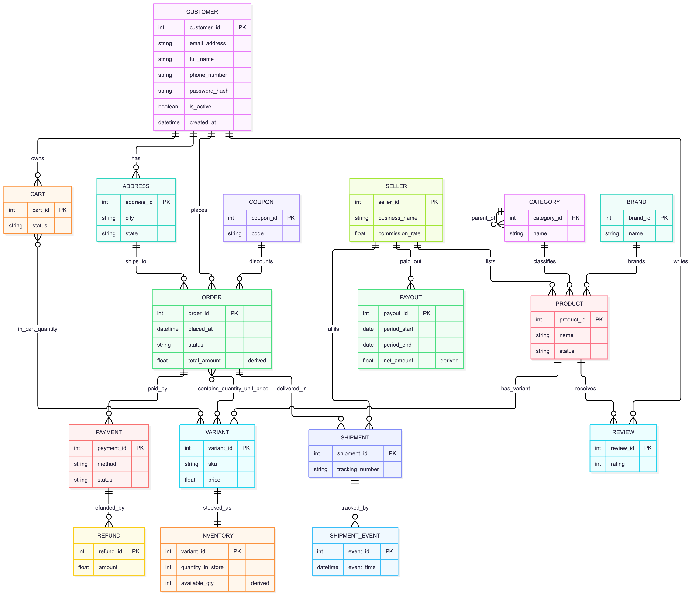

# Konga: Database design report (Portfolio 1)

This report shows how the database for a simulated marketplace based on how Konga is designed. It follows the seven database design stages from Study Session 1, meaning from requirement analysis (particularly identifying user needs) to planning maintenance. The [case study](case-study.md) document provides as much background and scope as possible.

## Contents

1. [Stage 1: Requirements analysis](#stage-1-requirements-analysis)
2. [Stage 2: Conceptual design (Entity-Relationship model)](#stage-2-conceptual-design-entity-relationship-model)
3. [Stage 3: Logical design (relational schema)](#stage-3-logical-design-relational-schema)
4. [Stage 4: Physical design](#stage-4-physical-design)
5. [Stage 5: Implementation](#stage-5-implementation)
6. [Stage 6: Testing and evaluation](#stage-6-testing-and-evaluation)
7. [Stage 7: Deployment and maintenance](#stage-7-deployment-and-maintenance)


**Supporting documents**

| Document | What it covers |
|---|---|
| [`case-study.md`](case-study.md) | Konga background and scope |
| [`normalisation.md`](normalisation.md) | Worked 1NF to BCNF decomposition and deliberate exceptions |
| [`good-database-checklist.md`](good-database-checklist.md) | Characteristics of a good database, checked against this design |
| [`limitations-of-traditional-dbms.md`](limitations-of-traditional-dbms.md) | Limits of the relational approach, leading into Portfolios 4 and 5 |

## Stage 1: Requirements analysis

*Study Session 1(stage 1): identify the purpose of the database, user requirements and data needs, key entities/attributes/relationships, and functional and non-functional requirements.*

### Purpose
The database supports a simulated marketplace where several sellers can list products. Customers browse the catalogue, place orders and make payments. Konga logistics or the seller as the case maybe  handles delivery, and sellers receive payouts for their sales.

#### Please note: that every data here is not real, and the design does not depict Konga's actual database.

### Users and what they need

| User | Needs from the database |
|---|---|
| Customer | Browse and search the catalogue, keep a cart, place orders, pay, track delivery, review products |
| Seller (merchant) | List products and variants (product variations), manage stock, see orders and monthly revenue, receive payouts |
| Logistics / delivery staff | Shipments per order and seller, tracking events |
| Customer support | Look up a customer's orders, payments and shipments (but never passwords) |
| Admin / finance | Coupons, refunds, payouts, commission |
| Analyst | Aggregated sales and stock figures without personal data |

### Functional requirements
1. Register customers and store multiple delivery addresses, with one address set as the default address for a customer.
2. Allow sellers to create products with variants (product variations), each with a unique Stock Keeping Unit (SKU) and a price. Organise products by category and optional brand; categories can also have subcategories.
3. Track stock per variant (product variation); never allow negative stock or reserve more than that which is available.
4. Allow each customer at most one open cart. At checkout, create an order from its items, store the quantity and purchase price of each variant (product variation), and mark the cart as checked out.
5. Allow an order to include items from several sellers, with at most one shipment per seller for that order.
6. Record payments (card, wallet, bank transfer, pay on delivery) and refunds.
7. Record shipment status and tracking events.
8. Allow each customer to review a product only once, with a rating ranging from. 1 - 5, and an optional comment.
9. Record seller payouts for a defined period, including gross sales, commission, net amount and payment status.
10. Support percentage and fixed-amount coupons with validity periods, and allow at most one coupon per order.

### Non-functional requirements

| Requirement | How it shows up in the design |
|---|---|
| Data integrity and consistency | Keys, foreign keys, CHECK constraints, transactions (Portfolio 3) |
| Performance | Indexing and query tuning (Portfolio 2) |
| Security | Least-privilege roles and restricted access to password hashes and personal data |
| Scalability / availability | Partitioning and replication (Portfolio 5), NoSQL for flexible data (Portfolio 4) |
| Backup and recovery | Verify backup and restoration using `pg_dump` and a restore test; see [backup and restore evidence](../evidence/backup-restore-test.txt) |

These requirements guide the work across the portfolios. 
The schema enforces rules such as valid prices and unique email addresses. Operations such as checkout and stock reservation need transaction logic because several changes must succeed together. The later stages and portfolios cover indexing, access control, replication and recovery.

### Entities identified
The main conceptual entities are Customer, Address, Seller, Category, Brand, Product, Variant (product variation), Inventory, Cart, Coupon, Order, Payment, Refund, Shipment, ShipmentEvent, Review and Payout.

Cart–Variant (product variation) and Order–Variant (product variation) are **many-to-many relationships**: a cart or order can contain several variants (product variations), and a variant (product variation) can appear in several carts or orders. These relationships have their own attributes:

- **Cart–Variant (product variation):** `quantity` records how many units of a variant (product variation) are in a particular cart.
- **Order–Variant (product variation):** `quantity` and `unit_price` record how many units were ordered and their price at the time of purchase.

The quantity belongs to a particular cart or order. For example, one cart may contain 2 units of a variant (product variation) while another contains 5. To store these details, the logical design introduces **CartItem and OrderItem associative entities**, implemented as `cart_items` and `order_items`. The quantity and purchase price are attributes of the relationship; CartItem and OrderItem represent those relationships as entities.

The [conceptual design](#stage-2-conceptual-design-entity-relationship-model) shows the entities and relationships, and the [logical design](#stage-3-logical-design-relational-schema) gives the full attribute and table definitions.

### Business rules (to be enforced in the database where possible)
1. Variant (product variation) prices, purchase prices and order totals must be non-negative. Cart and order item quantities must be positive; review ratings must be between 1 and 5.
2. Stock on hand and reserved stock must be positive, and reserved stock must not exceed stock available.
3. Each variant (product variation) has a unique SKU. A variant (product variation) can occur only once in a particular cart or order; its quantity records multiple units.
4. Each customer can have only one default address and  one open cart. These limits do not require a customer to have either.
5. A coupon's end date must be after its start date. Its discount value must be positive, and a percentage discount must not exceed 100%.
6. A successful payment must have a payment date. Payment and refund amounts must be positive.
7. Each customer can submit only one review per product, and each order can have at one shipment per seller.
8. A payout period must end on or after its start date. Gross sales and commission must be positive, net amount must equal gross sales minus commission, and each seller can have only one payout for the same start and end dates.

[Back to contents](#contents)

## Stage 2: Conceptual design (Entity-Relationship model)

_Study Session 1 (stage 2): develop a model that describes the data independently of a particular database system. Identify the entities, attributes, relationships, keys and cardinalities using an entity–relationship (ER) diagram._

I used **Chen notation** for the conceptual diagram, following the study session:

- A **rectangle** represents an entity.
- An **ellipse** represents an attribute; an underlined attribute identifies a key.
- A **dashed ellipse** represents a derived attribute, calculated from other data.
- A **diamond** represents a relationship between entities.
- The labels **1**, **M** and **N** indicate relationship cardinalities. Both M and N mean “many”; for example, 1:N means one-to-many and M:N means many-to-many. These labels show the maximum cardinalities, rather than whether participation is optional or mandatory.



The [generation script](diagrams/make_er_chen.py) creates the Graphviz diagram source. An [SVG version](diagrams/er-design-chen.svg) and a [Mermaid version](diagrams/er-conceptual-chen.mmd) are also available. Each entity shows its key and a few selected attributes so that the diagram is easy to read. The [logical design and data dictionary](#stage-3-logical-design-relational-schema) provide the full table and column definitions.

### Modelling decisions

- **Products and variants (product variations).** A Product describes the general item. A Variant (product variation) describes the version a customer can buy, such as a particular colour, size or storage capacity. Each variant (product variation) has its own SKU, price and stock record, so carts and orders can identify exactly which version the customer selected.
- **Many-to-many relationships with attributes.** The CONTAINS relationship between Order and Variant (product variation) has `quantity` and `unit_price` attributes. The IN_CART relationship between Cart and Variant (product variation) has a `quantity` attribute. These attributes describe how a product variation appears in a particular order or cart. The logical design stores them in the OrderItem and CartItem associative entities, implemented as `order_items` and `cart_items`.
- **Derived attributes.** Dashed ellipses identify values calculated from other data: `Order.total_amount` is based on the order items and any applicable discount; `Inventory.available_qty` is stock on hand minus reserved stock; and `Payout.net_amount` is gross sales minus commission. The schema stores the order total and net payout amount, while available stock is calculated when needed. See [controlled denormalisation](normalisation.md#5-deliberate-exceptions-controlled-denormalisation) for the reasons behind these choices.
- **Recursive relationship.** The PARENT_OF relationship connects Category to itself, allowing a category to contain subcategories. Each category has only one parent and can have several children.
- **One-to-one relationship.** The STOCKED_AS relationship links Variant (product variation) to Inventory. Each variant (product variation) should have one stock record. This record is separate because stock changes independently of product descriptions and prices. Using the same column as both a primary key and a foreign key prevents a variant (product variation) from having more than one inventory record. The insertion logic must still ensure that a record is created for every variant (product variation).
- **Multiple values and composite information.** A customer may have several addresses, and a shipment may have several tracking events. Separate Address and ShipmentEvent entities store these records. Address details are split into fields such as `line1`, `city`, `state` and `postal_code`. This avoids repeating groups and supports atomic column values in the relational design, consistent with first normal form (1NF).
- **Existence-dependent entities.** A ShipmentEvent belongs to a Shipment and cannot exist without it. It has its own identifier, `event_id`, so it is not modelled as a weak entity identified through its owner's key. The foreign key enforces the dependency, and deleting a shipment also deletes its tracking events.

### Logical-level ER diagram (crow's foot)

The diagram below shows how the design translates into tables. It uses **crow’s foot notation** to show the columns and foreign-key relationships. Its source is [er-diagram.mmd](er-diagram.mmd). Unlike the conceptual Chen diagram, this diagram includes the associative tables used to implement the many-to-many relationships.


[Back to contents](#contents)


## Stage 3: Logical design (relational schema)

*Study Session 1 (stage 3): convert the E-R Diagram to a relational schema (tables, columns, relationships), define primary/foreign keys and constraints, normalise, and ensure integrity and consistency.*

### Mapping rules applied (ER -> relational)
| ER construct | Relational result | Example |
|---|---|---|
| Entity | One table, key attribute -> primary key | Customer -> `customers(customer_id PK)` |
| 1:N relationship | Foreign key on the "N" side | Customer 1-N Order -> `orders.customer_id FK` |
| M:N relationship (with attributes) | Table with a composite key or FK pair plus the relationship's attributes | CONTAINS -> `order_items(order_id, variant_id, quantity, unit_price)` |
| 1:1 relationship | Shared primary key | `inventory.variant_id` is both PK and FK to `product_variants` |
| Recursive relationship | Self-referencing FK | `categories.parent_id -> categories.category_id` |
| Derived attribute | Omitted, or stored deliberately and protected by a CHECK | `payouts.net_amount` with `CHECK (net = gross - commission)` |

The complete PostgreSQL schema contains 19 tables and is defined in [01_schema.sql](../sql/01_schema.sql).

### Data dictionary (summary)
| Table | Primary key | Foreign keys | Notable constraints |
|---|---|---|---|
| customers | customer_id | | UNIQUE(email)_address; email address format CHECK |
| addresses | address_id | customer_id | one default per customer (partial unique index) |
| sellers | seller_id | | UNIQUE(email_address); status IN (...); commission 0-50 |
| categories | category_id | parent_id (self) | UNIQUE(slug); not its own parent |
| brands | brand_id | | UNIQUE(name) |
| products | product_id | seller_id, category_id, brand_id | status IN (draft, live, delisted) |
| product_variants | variant_id | product_id | UNIQUE(sku); price >= 0 |
| inventory | variant_id | variant_id | on_hand >= 0; 0 <= reserved <= on_hand |
| carts | cart_id | customer_id | one open cart per customer (partial unique index) |
| cart_items | (cart_id, variant_id) | cart_id, variant_id | quantity > 0 |
| coupons | coupon_id | | UNIQUE(code); valid_to > valid_from; percent <= 100 |
| orders | order_id | customer_id, shipping_address_id, coupon_id | status IN (...); total >= 0 |
| order_items | order_item_id | order_id, variant_id | UNIQUE(order_id, variant_id); quantity > 0 |
| payments | payment_id | order_id | UNIQUE(provider_ref); amount > 0; successful => paid_at set |
| refunds | refund_id | payment_id | amount > 0 |
| shipments | shipment_id | order_id, seller_id | UNIQUE(order_id, seller_id); UNIQUE(tracking_number); dates ordered |
| shipment_events | event_id | shipment_id | |
| reviews | review_id | customer_id, product_id | UNIQUE(customer_id, product_id); rating 1-5 |
| payouts | payout_id | seller_id | net = gross - commission; UNIQUE(seller, period) |

### Normalisation
The [normalisation walkthrough](normalisation.md) starts with a flat order sheet and takes it through 1NF, 2NF, 3NF and BCNF. It follows the approach used in the study session's student/course/instructor example and explains the reasons for the deliberate exceptions.

### Referential actions
I used `ON DELETE CASCADE` for dependent records such as addresses, cart items, shipment events and reviews. For master and history tables, the default restrictive behaviour protects related data. For example, a category or seller cannot be deleted while other records still reference it. Test T11 in `evidence/constraint-tests-output.txt` checks this behaviour.

[Back to contents](#contents)

## Stage 4: Physical design

*Study Session 1, 1.1.2 (stage 4): select the DBMS and storage structures (indexes, partitions, views), define access paths, configure security policies and backup mechanisms, establish indexing strategies.*

| Decision | Choice | Why | Where |
|---|---|---|---|
| DBMS | PostgreSQL 16 | Open source RDBMS with full ACID support, rich index types, partitioning, replication, JSON support | all portfolios |
| Data types | `BIGINT IDENTITY` keys, `NUMERIC(12,2)` money, `TIMESTAMPTZ`, `VARCHAR` with limits | Exact money arithmetic, time zones, bounded text | `01_schema.sql` |
| Storage / file organisation | Heap tables with B-tree primary-key indexes by default | PostgreSQL's native organisation; alternatives are examined in Portfolio 2 | Portfolio 2 |
| Indexing strategy | Created after measuring real queries: composite, partial, trigram GIN | Indexes speed reads but slow writes, so only where plans show a benefit | `portfolio-2/.../03_indexes.sql` |
| Partitions | Horizontal partitioning of large tables by region/date | Supports scale and distribution | Portfolio 5 |
| Views | `v_order_summary`, `v_seller_sales`, `v_low_stock` | Stable, simplified access paths; hide joins | `../sql/04_physical_design.sql` |
| Security policy | Three least-privilege roles; column-level grant hides `password_hash` | Confidentiality (CIA triad, Session 3, 3.2.2.1) | `../sql/04_physical_design.sql` |
| Backup | `pg_dump` custom format + `pg_restore`; tested | Backup and recovery characteristic | `../evidence/backup-restore-test.txt` |

### Roles
| Role | Can | Cannot |
|---|---|---|
| `konga_app` | SELECT/INSERT/UPDATE/DELETE on all tables | Run DDL (create/drop tables) |
| `konga_support` | Read orders, items, payments, shipments, addresses; read customers except `password_hash` | Change any data; read password hashes |
| `konga_analyst` | Read aggregated views only | Read personal data in base tables |

[Back to contents](#contents)

## Stage 5: Implementation

The study material lists stages 1–4 and then moves to stages 6–7. In this report, I use stage 5 for implementation: creating the database, loading sample data and applying the views and access permissions before testing.

| Step | Script |
|---|---|
| Create schema, tables, keys, constraints | `../sql/01_schema.sql` |
| Load a small synthetic data set | `../sql/02_sample_data.sql` |
| Create views, roles and grants | `../sql/04_physical_design.sql` |
| Large-scale data for performance work | `../../portfolio-2-query-optimisation/sql/01_seed_large.sql` |

All data used here is synthetic. The portfolio README explains which order to run the scripts in and provides the commands.

[Back to contents](#contents)

## Stage 6: Testing and evaluation

*Study Session 1, 1.1.2 (stage 6): data validation and integrity checks, performance testing, security testing, functional testing.*

| Test type (from the study session) | What I did | Result | Evidence |
|---|---|---|---|
| Data validation and integrity | 12 negative tests (T1-T12) that each try to break a rule (duplicate email, negative price, bad foreign key, rating 6, second default address, and so on) | All 12 rejected by the intended constraint | `../sql/03_constraint_tests.sql`, `../evidence/constraint-tests-output.txt` |
| Functional | 4 assertion tests: order totals match items, no orphan orders, referential integrity, view row counts | 4 of 4 passed | `../sql/05_functional_and_security_tests.sql`, `../evidence/functional-security-tests-output.txt` |
| Security | 4 role tests: support cannot read `password_hash` or update orders; analyst cannot read customers; app cannot drop tables | 4 of 4 passed | same file |
| Performance | Before/after execution plans at 1.5 M rows | See Portfolio 2 | `../../portfolio-2-query-optimisation/` |
| Backup and recovery | Dump, drop the schema, restore, compare row counts | Counts matched | `../evidence/backup-restore-test.txt` |

[Back to contents](#contents)

## Stage 7: Deployment and maintenance

*Study Session 1, 1.1.2 (stage 7): monitoring and optimising queries, applying updates/patches, backups and disaster recovery, modifying the database as business needs evolve.*

### Routine maintenance plan
| Task | How (PostgreSQL) | Frequency |
|---|---|---|
| Refresh optimiser statistics | `ANALYZE` (autovacuum does this automatically; run manually after bulk loads) | After bulk loads |
| Reclaim dead rows | `VACUUM` (autovacuum) | Continuous |
| Find slow queries | `pg_stat_statements`, `EXPLAIN (ANALYZE, BUFFERS)` | Weekly |
| Watch locks and sessions | `SELECT * FROM pg_stat_activity;` and `pg_locks` | When contention is reported |
| Backups | `pg_dump -Fc` nightly; restore test each month | Nightly / monthly |
| Disaster recovery | Replica with promotion (Portfolio 5) | Continuous replication |
| Security | Review role grants; rotate credentials; patch PostgreSQL minor versions | Quarterly |

### Schema evolution
Future schema changes would use versioned migration scripts, such as `ALTER TABLE ...`, committed to Git. For example, extending this model to support a second warehouse would require changes to `inventory`, including a `warehouse_id`. This would address the single-warehouse limitation noted in the README.

### Monitoring queries
```sql
SELECT pid, state, wait_event_type, query FROM pg_stat_activity WHERE datname = current_database();
SELECT relname, n_live_tup, n_dead_tup, last_autovacuum FROM pg_stat_user_tables ORDER BY n_dead_tup DESC LIMIT 10;
```

[Back to contents](#contents)
