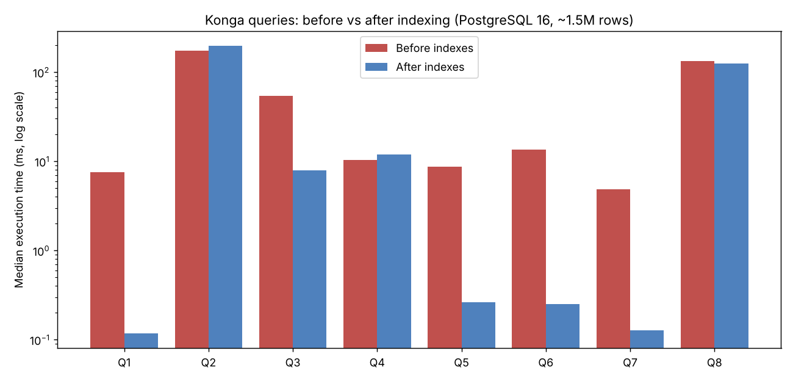

# Performance analysis (Portfolio 2)

> Historical analysis: these measurements and diagrams come from the earlier integer-ID schema. The current SQL uses UUID-as-text IDs and `quantity_in_store`. Rerun the updated scripts before using these timings as evidence for the current design. Buffer totals from the earlier experiment harness may include double-counted child-node buffers; the updated harness reads the root counter.

**Setup:** PostgreSQL 16.15, default configuration, single local instance. Synthetic Konga data of about 1.5 million rows (orders 150k, order_items 450k, shipments ~314k, reviews 60k, products 20k, variants 50k). Each query was run once to warm the cache and then three times; the table reports the **median** `Execution Time` from `EXPLAIN (ANALYZE, BUFFERS)`. Full plans and result samples are in `evidence/before/` and `evidence/after/`.

| Query | What it does | Before (ms) | After (ms) | Change |
|---|---|---|---|---|
| Q1 | A customer's order history | 7.61 | 0.12 | 65x faster |
| Q2 | Top 10 sellers by units, last 90 days | 172.61 | 197.54 | no real change |
| Q3 | One seller's monthly revenue | 54.42 | 7.94 | 6.9x faster |
| Q4 | Low-stock live products in a category | 10.39 | 12.02 | no real change |
| Q5 | Product name search (`ILIKE '%laptop 1234%'`) | 8.64 | 0.27 | 32.6x faster |
| Q6 | Abandoned pending orders | 13.56 | 0.25 | 53.6x faster |
| Q7 | Latest reviews on a product | 4.87 | 0.13 | 38x faster |
| Q8 | Top customers by lifetime spend | 132.30 | 125.86 | no real change |

## Where indexes helped, and why

- **Q1 (orders by customer).** Before: `Seq Scan on orders` read all 150,000 rows to find 7, then sorted them. After: the composite index `(customer_id, placed_at DESC)` finds the rows directly and returns them already in order, so the sort disappears.
- **Q5 (name search).** A normal B-tree index cannot serve `ILIKE '%text%'` because the pattern starts with a wildcard. A trigram GIN index (`pg_trgm`) splits names into 3-letter pieces so the planner can use an index.
- **Q6 (pending orders).** Only about 10% of orders are `pending`. A *partial* index on `placed_at WHERE status = 'pending'` stores just that slice (344 kB, compared with 3.3 MB for the full `placed_at` index) and is already sorted by date.
- **Q7 (product reviews).** `(product_id, created_at DESC)` returns the newest reviews for one product straight from the index.
- **Q3 (seller revenue).** The plan changed from scans plus a parallel hash join to a chain of index lookups: seller -> products -> variants -> order items -> orders. Each step touches only the rows for that seller (45 products, about 1,000 order lines).

## Where indexes did not help, and why

- **Q2 and Q8** aggregate a large share of the data (about 22% of orders for Q2, all non-cancelled orders for Q8). Reading most of a table is cheaper with a sequential scan, and the cost is dominated by the join and the aggregation. In Q2 the planner did use the new `placed_at` index (a bitmap scan on orders), but the 450,000-row `order_items` scan and hash joins still dominate. The small differences are within run-to-run noise on a shared machine: the individual runs varied by roughly 20%.
- **Q4** already ran in about 10 ms on 20,000 products. The planner used the new indexes (`idx_products_category_live`, an index-only scan on `idx_inventory_low_stock`) but the remaining cost is a scan of the 50,000-row `product_variants` table, so there was nothing meaningful to save. At this table size the gain would be small, and it would grow with data volume.

## Costs and trade-offs

- The 10 new indexes add about 16 MB on disk (`evidence/new-index-sizes.txt`).
- Each index must be updated on every `INSERT`/`UPDATE`/`DELETE` of its table, so write-heavy tables (orders, order_items) pay more. I did not benchmark write speed here.
- This is why I added indexes only for specific queries, used partial indexes where the filter is selective, and left Q2/Q8 alone: for analytics queries like these, a better approach would be a summary table or materialised view.

## Limitations
- Synthetic, evenly distributed data. Real marketplace data is skewed (a few very popular products and sellers), which can change plans.
- A small, cached, single-node setup. On larger data or cold caches, the gap for indexed queries would be larger and Q2/Q4 would show different behaviour.
- Medians of three runs; treat differences below about 20% as noise.
